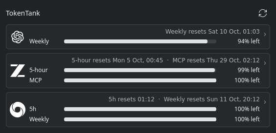
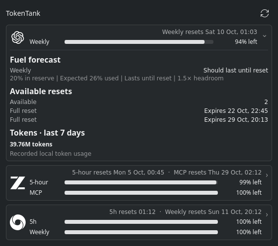

# TokenTank: A KDE Plasma widget using CodexBar

A small KDE Plasma 6 widget for keeping an eye on your AI subscriptions. TokenTank is a frontend wrapper around [CodexBar](https://github.com/steipete/CodexBar).

**The CodexBar CLI is required.** Authentication, account configuration, API keys and subscription usage fetching are handled through CodexBar and the provider clients it supports. TokenTank presents that information in a compact KDE panel popup.

## Supported subscriptions

For now, these four subscriptions are supported because they are the ones I use and have access to:

| Subscription | CodexBar provider |
| --- | --- |
| OpenAI Codex | `codex` |
| Anthropic Claude | `claude` |
| z.ai / GLM Coding Plan | `zai` |
| Google / Gemini through Antigravity | `antigravity` |

The Google card shows Gemini usage only. Disconnected providers are hidden. CodexBar supports more providers; TokenTank currently focuses on these four.

## How it works

- Click the panel icon to open the popup and refresh quotas, or use the refresh button.
- Bars show the percentage remaining and shrink from right to left as usage increases.
- Each card shows the quota windows and reset times actually reported by its provider.
- Expand a card for its fuel forecast, available extra credits and resets, and recorded token usage for the last seven days. Availability depends on what CodexBar can report.
- The popup resizes to its contents. Token history is fetched on expansion and briefly cached to avoid repeated scans.
- Refresh skips providers already loading, so a slow provider does not block the others. History requests use CodexBar's scan cache.

## Install

Requirements:

- KDE Plasma 6 with Kirigami and Plasma5Support.
- A working CodexBar CLI installation at `/usr/bin/codexbar`.
- `/usr/bin/timeout`, provided by GNU coreutils.

Install and configure CodexBar first; see its [CLI documentation](https://github.com/steipete/CodexBar/blob/main/docs/cli.md). Sign in or configure each provider through CodexBar and its supported clients.

From this directory, install the widget:

```bash
kpackagetool6 --type Plasma/Applet --install .
```

Then enter the KDE panel's edit mode, choose **Add Widgets**, and add **TokenTank**.

For an existing installation, use:

```bash
kpackagetool6 --type Plasma/Applet --upgrade .
```

## Development checks

The offline checks use synthetic data and require Python 3 and the Qt 6 declarative/test tools:

```bash
python tests/test_refresh.py
python tests/test_gemini.py
QT_QPA_PLATFORM=offscreen QT_QUICK_BACKEND=software /usr/lib/qt6/bin/qmltestrunner -input tests
```

Set `QML_BIN` if the Qt 6 `qml` executable is installed somewhere other than `/usr/lib/qt6/bin/qml`.

Input limits protect parsing and rendering: 1,048,576 output characters, 32 quota windows, and 64 displayed detail rows per provider; labels are limited to 256 characters and detail text to 1,024. Invalid or oversized results show an error and retain saved values. These limits apply after Plasma's executable engine has captured the output.

## Screenshots

Captured from the widget using live CodexBar data. This setup has Codex, z.ai and Google connected; Claude is hidden because it is not connected.

Open popup:



Expanded Codex card:



## License and credits

TokenTank uses the **MIT License**, the same license as [CodexBar](https://github.com/steipete/CodexBar/blob/main/LICENSE). See [LICENSE](LICENSE).

Thanks to CodexBar for the provider integrations and usage data. The DeepMind icon comes from [LobeHub Icons](https://github.com/lobehub/lobe-icons), also licensed under MIT; its copyright notice is retained in LICENSE.
